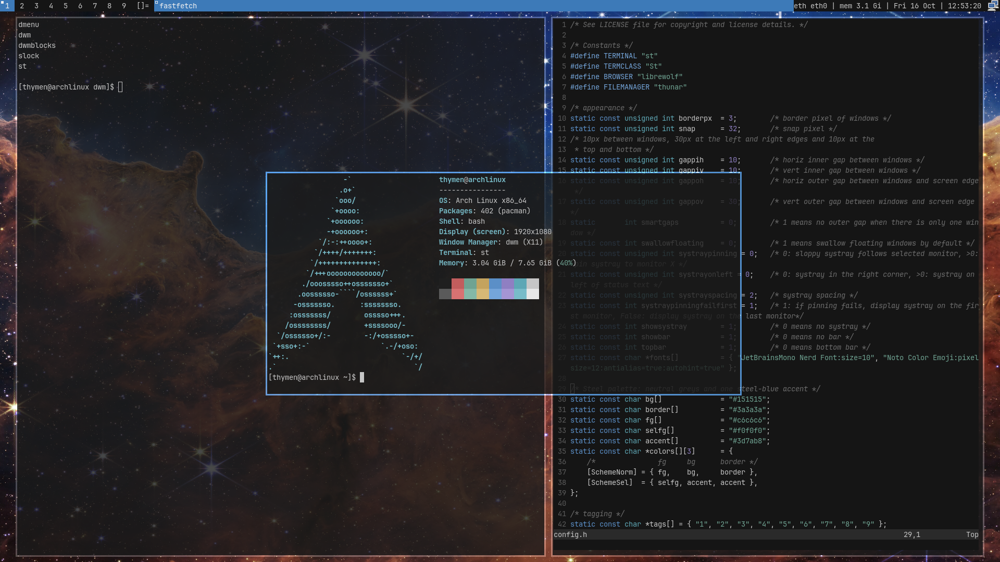
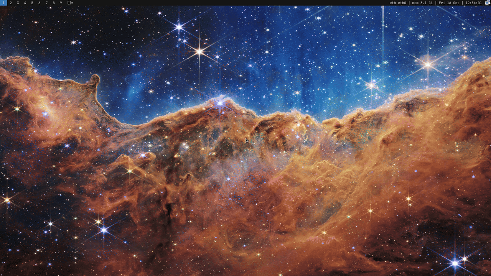

# DWM Auto Rice Bootstrapping Script (DARBS)



My dotfiles for dwm, st, dmenu, slock, dwmblocks and dunst, with Neovim and Helix themes. Everything uses **Steel**: neutral greys with one steel-blue accent. dwm 6.8 has gaps, extra layouts, window swallowing and a plain text status bar you can click; st has scrollback, transparency and clickable URLs.



## Install

For Arch and Arch based distributions, Fedora, and Artix with dinit. **Read a script before you run it.** Run it as your own user, not as root; it uses `sudo` where needed.

```bash
git clone https://github.com/tcvscheppingen/DARBS.git
cd DARBS
./auto-rice.sh        # on Artix: ./auto-rice-artix.sh
```

Then reboot. The script:
- installs Xorg, PipeWire, NetworkManager, Bluetooth, fonts, Neovim, Thunar and LibreWolf, plus the Intel or AMD GPU drivers it finds (not NVIDIA)
- backs up the configs it replaces to `~/.config/darbs-backup-<date>/`
- copies the dotfiles, then builds dwm, st, dmenu, slock and dwmblocks and installs them to `/usr/local`
- asks how to start dwm: on login on TTY1, or from a minimal LightDM login screen (`RICE_LOGIN=tty|dm|none` answers in advance)

Already have the packages? `./move-config-files.sh` only copies the dotfiles and builds the suckless programs.

With the LightDM login screen, locking the screen also uses LightDM; otherwise it uses slock.

## Key bindings

`mod` is the Super key.

| Keys | Action |
|---|---|
| `mod + Return` / `mod + d` | Terminal / run a program (dmenu) |
| `mod + w` / `mod + shift + w` / `mod + r` | Browser / `nmtui` / file manager |
| `mod + q` | Close the window |
| `mod + j/k` / `mod + shift + j/k` | Focus / move the window down or up the stack |
| `mod + v` / `mod + shift + v` | Focus the master / make the window the master |
| `mod + space` / `mod + shift + space` | Swap with the master / toggle floating |
| `mod + h/l` / `mod + o`, `mod + shift + o` | Master area smaller or larger / more or fewer master windows |
| `mod + t y u i` (with `shift`) | Layouts: tile (bstack), spiral (dwindle), deck (monocle), centered master (floating) |
| `mod + shift + f` | Floating layout |
| `mod + 1…9` / `mod + shift + 1…9` | Go to a tag / move the window to a tag |
| `mod + 0` / `mod + Tab` | All tags / previous tag |
| `mod + Left/Right` (with `shift`) | Focus (move the window to) the other display |
| `mod + a` / `mod + shift + a` / `mod + z/x` | Toggle / reset / grow or shrink the gaps |
| `mod + b` | Toggle the bar |
| `mod + minus/equal` / `mod + shift + m` | Volume down or up / mute |
| `mod + Backspace` | System menu: lock, leave or renew dwm, sleep, reboot, shutdown (`sysact`) |
| `mod + F3` | Display arrangement (`displayselect`) |
| `Print` / `shift + Print` | Screenshot / screenshot menu (`maimpick`) |
| `mod + Print` / `mod + Delete` | Start / stop a recording (`dmenurecord`) |
| `mod` + left / right drag | Move / resize a window |

<details>
<summary>st key bindings</summary>

In st, `alt` is the modifier:

| Keys | Action |
|---|---|
| `alt + k/j`, `alt + Up/Down` / `alt + u/d`, `alt + PageUp/PageDown` | Scroll up or down a line / a page (also the mouse wheel) |
| `alt + shift + k/j` / `alt + Home` | Zoom in or out / reset the font size |
| `alt + c` / `alt + v`, `shift + Insert` | Copy / paste |
| `alt + l` / `alt + y` | Open / copy a URL on the screen |
| `alt + o` | Copy a command's output |
| `alt + a` / `alt + s` | More / less opaque |

</details>

## Good to know

- **Status bar:** click the network for `nmtui`, the volume for `pulsemixer` (middle click mutes, scroll changes it), and memory for `htop`.
- **No sound?** If the volume shows `vol dummy` on an Intel laptop, run `sound-fix`.
- **Locking:** after 5 minutes idle, and before sleep. The displays turn off after 10 minutes. The times are the `xset` lines in `~/.config/x11/xinitrc`.
- **Wallpaper:** `setbg image.jpg` changes it, and `setbg folder` picks a random image from a folder.
- **Changing dwm:** edit `~/.local/src/dwm/config.h`, run `make && sudo make install` there, then "renew dwm" in `sysact` restarts dwm without closing your windows. The same goes for st, dmenu, slock and dwmblocks.

<details>
<summary>Patches</summary>

dwm (patch files in `.local/src/dwm/patches/`):
- [vanitygaps](https://dwm.suckless.org/patches/vanitygaps/): gaps and extra layouts (bstack, spiral, deck, centered master)
- [swallow](https://dwm.suckless.org/patches/swallow/): a program started from st takes the terminal's place until it closes
- [stacker](https://dwm.suckless.org/patches/stacker/): move windows up and down the stack
- [statuscmd](https://dwm.suckless.org/patches/statuscmd/): clickable status bar blocks (scripts in `~/.local/bin/statusbar`)
- [systray](https://dwm.suckless.org/patches/systray/): a system tray in the bar

st 0.8.5, with the patches merged into the source: scrollback, zoom, alpha (transparency through xcompmgr), xresources, externalpipe (URLs and command output from a dmenu list), boxdraw, ligatures and color emoji.

</details>

## Palette

| | Color | |
|---|---|---|
| Background | `#151515` | Bar, terminal, menus, editors |
| Border | `#3a3a3a` | Unfocused windows |
| Text | `#c6c6c6` | |
| Accent: steel blue | `#3d7ab8` | Focused window, selected tag, dmenu, notifications |
| Red | `#c25d5d` | Errors, wrong password, critical notifications |

The colors are in each program's `config.h` in `~/.local/src`, in `~/.config/dunst/dunstrc`, and in `~/.config/nvim/colors/steel.lua` and `~/.config/helix/themes/steel.toml`. The script doesn't install [Helix](https://helix-editor.com); the theme is used once you do.

## Credits
- [suckless.org](https://suckless.org) for dwm, st, dmenu, slock and the [patches](https://dwm.suckless.org/patches/)
- Luke Smith's [dwm](https://github.com/LukeSmithxyz/dwm) (the key bindings), [st](https://github.com/LukeSmithxyz/st), [dwmblocks](https://github.com/LukeSmithxyz/dwmblocks) and [voidrice](https://github.com/LukeSmithxyz/voidrice) scripts
- Wallpaper: ["Cosmic Cliffs" in the Carina Nebula](https://science.nasa.gov/asset/webb/cosmic-cliffs-in-the-carina-nebula-nircam-and-miri-composite-image/) by NASA, ESA, CSA and STScI (James Webb Space Telescope, public domain)
